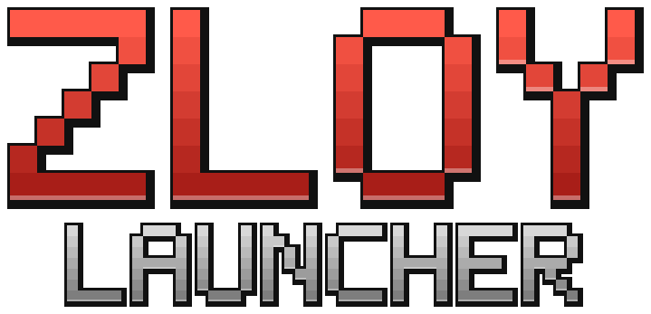

> **🍴 Форк [BetaCraft Launcher](https://github.com/betacraftuk/betacraft-launcher)** — основан на версии [1.09_17](https://github.com/betacraftuk/betacraft-launcher/tree/1.09_17) (ветка `v1`), лицензия GPL-3.0. Всё, что сделано в BetaCraft, — заслуга его авторов; здесь — изменения ZloyLauncher поверх него.

[](https://github.com/betacraftuk/betacraft-launcher)
[](https://github.com/zack14ff/ZloyLauncher/releases/latest)
[](https://github.com/zack14ff/ZloyLauncher/actions/workflows/build-and-release.yml)

# ZloyLauncher



Лаунчер старых версий Minecraft (от Pre-Classic до 1.5.2) в старом добром виде: фон из земли, кнопки на своих местах, тёмная лента новостей.

**Скачать:** [последний релиз](https://github.com/zack14ff/ZloyLauncher/releases/latest) — `ZloyLauncher.exe` (Windows, двойной клик) или `ZloyLauncher.jar`.

## Что добавлено по сравнению с BetaCraft
- **Несколько аккаунтов**: лицензия (вход через Microsoft) и сколько угодно пиратских.
  - кнопка **Аккаунты** на главном экране: быстрый выбор, добавление лицензии или пиратки;
  - окно **Управление аккаунтами**: выбрать, добавить, переименовать, удалить;
  - ник пиратского аккаунта можно вписать прямо в поле на главном экране;
  - если войти в лицензию не получилось (например, нет интернета), она остаётся в списке, а игра идёт с пиратского аккаунта.
- **Связка с BetaCraft Launcher**: можно работать в папке BetaCraft (`.betacraft`) с общими версиями, сборками и аккаунтами.
  - при первом запуске лаунчер сам предложит это, если найдёт BetaCraft;
  - потом это меняется в меню **Папки** (своя папка / папка BetaCraft / любая другая), после выбора лаунчер перезапускается.
- **Сборки** — своя вкладка: плитки с иконками (23 встроенные пиксельные или своя картинка), заметки, время в игре, копирование, поиск.
- **Выбор Java** как в Prism Launcher: все Java на компьютере с версией и архитектурой, Java 8 подсвечена.
- **Мои серверы** — своя вкладка: свои серверы с иконками и онлайном, вход прямо из лаунчера, автоопределение версии сервера (по списку BetaCraft или опросом сервера) или выбор версии вручную, включая свои/модовые.
- **Статус в Discord**: сборка, сервер и его онлайн («19 из 400»); что показывать — настраивается.
- **Свой прокси скинов и звуков**: прокси BetaCraft (`betacraft.uk:11705`) больше не работает, поэтому лаунчер сам отдаёт старым версиям звуки (из хранилища Mojang) и скины/плащи (из профилей Mojang).
- **Головы игроков** в окне аккаунтов.
- **ZloyLauncher.exe как настоящая программа**: закрепляется на панели задач и в Пуске, создаёт ярлыки (меню **Папки**), повторный запуск открывает уже запущенный лаунчер, есть портативный режим (файл `portable.txt` рядом с exe — данные хранятся рядом).
- Меню **Папки**: открыть папку сборки или папку лаунчера.
- Встроенный русский язык, работает без интернета.
- Встроенная страница новостей в стиле старого списка изменений BetaCraft.
- Новое имя, иконка и логотип. Своя папка данных: `%APPDATA%\.zloylauncher` (Windows), `~/.zloylauncher` (Linux), `~/Library/Application Support/zloylauncher` (macOS).
- Автообновление с серверов BetaCraft отключено (иначе оно заменило бы лаунчер на BetaCraft).

Всё остальное осталось от BetaCraft: исправления для старых версий, список серверов, каталог модов, дополнения, настройки сборок.

## Релизы
Релизы делаются сами: при пуше в `main` GitHub Actions собирает `.jar` и `.exe`, и если версии из `Launcher.VERSION` ещё нет среди релизов, публикует релиз `vX.Y.Z` с описанием из страницы «Новости» (`src/main/resources/changelog/ru.html`). Новая версия = поднять `VERSION` и добавить запись в «Новости».

## Сборка
Нужен JDK 17 или 21 (Gradle 8.14 не запускается на Java 25):

```
set JAVA_HOME=C:\Program Files\Java\jdk-17
gradlew build
```

Готовые файлы в `build/libs`:
- `ZloyLauncher.exe` — запуск двойным кликом, с иконкой. Лаунчер уже внутри: при запуске он распаковывается в `%LOCALAPPDATA%\ZloyLauncher` и запускается через найденную Java (сначала ищется Java 8). Собирается только на Windows (задача `gradlew exe`, используется компилятор C#, встроенный в Windows).
- `ZloyLauncher.jar` — то же самое для `java -jar ZloyLauncher.jar` (Linux, macOS).

Сборка приложения для macOS: `gradlew osxBuildApp`.

## Статус в Discord
Лаунчер показывает «Играет в ZloyLauncher» через своё Discord-приложение. Большая картинка — логотип по прямой ссылке на [discord/logo.png](discord/logo.png) в этом репозитории, маленькая — голова игрока со скином (с minotar.net; у пиратского аккаунта — скин игрока с таким же ником, если он есть). Другое приложение или картинку можно задать в `launcher/launcher.settings` (в папке данных): `discordAppId:ID` и `discordImageKey:ключ_или_https_ссылка`.

## Откуда что качается
Версии игры, библиотеки, языки, список серверов и моды по-прежнему загружаются с серверов BetaCraft (`files.betacraft.uk`, `api.betacraft.uk`). Звуки — с `resources.download.minecraft.net`, скины — через API Mojang. Вход в лицензию использует Microsoft-приложение BetaCraft, поэтому на странице входа Microsoft будет написано BetaCraft.

## Лицензия
GPL-3.0, как и у BetaCraft Launcher (см. [LICENSE](LICENSE)). Оригинальный код: https://github.com/betacraftuk/betacraft-launcher
